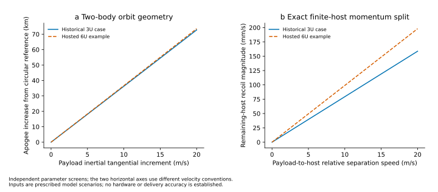
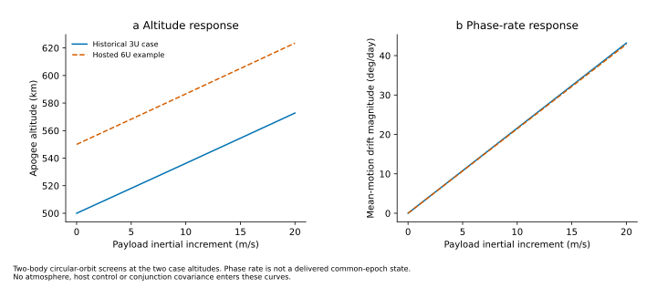
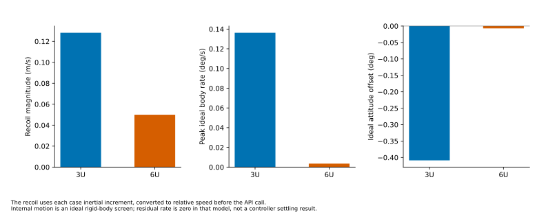
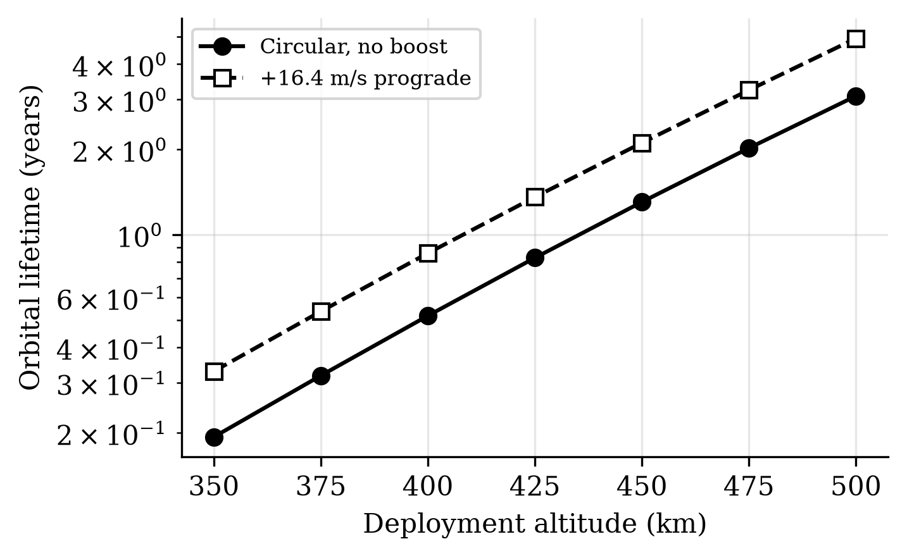

# Orbital Deployment Trade Study

<p align="center"></p>

[](https://github.com/aaaaaaaaaaaavm/orbital-deployment-trade-study/actions/workflows/ci.yml)
[](LICENSE)
[](pyproject.toml)
[](docs/PROVENANCE.md)

An installable preliminary calculator for tangential deployment impulses, phase drift, host
recoil and the rigid-body disturbance from a closed internal mass move.

**Status: two-body and rigid-body trade study.** This does not perform conjunction assessment,
replace a launch-provider analysis or establish flight safety. Atmosphere, covariance,
flexible modes and host control require higher-fidelity tools and mission data.

<p align="center">
  
  
</p>

<p align="center"><sub>The left sweep separates orbital-energy change from accumulated phase.
The right ledger separates external release recoil from the closed internal-mass disturbance.
All curves and bars are regenerated from the two committed cases.</sub></p>

## Why this exists

VOLLEY's astrodynamics record mixes four questions that do not have the same evidence:

1. what a tangential impulse does to a circular orbit;
2. how mean-motion difference accumulates phase;
3. what linear recoil magnitude the host receives;
4. what ideal angular motion follows an internal mass transfer.

### Common-epoch comparison boundary

Release time alone does not create a fixed along-track separation for two passive objects
released with identical states from the same unmanoeuvred circular host. The first object
continues around the orbit while the host advances; comparing states at their different
release epochs confuses elapsed orbital motion with separation at a common epoch.
The former “30 degrees from 468 seconds of waiting” argument is withdrawn.

The phase-drift output here is an ideal mean-motion difference after an imposed inertial
impulse. It is not a complete delivery-state comparison or an economic advantage claim.
A fair mission comparison propagates every payload to the same epoch and counts host
manoeuvres, release dispersion, installed mass, energy and operational constraints.
Lifetime predictions in retained source snapshots are model results, not measured service
benefits or results of this dependency-free calculator.

The first three are useful screening calculations. The fourth is here because a VOLLEY audit
found that peak rate had been mistaken for residual rate. A symmetric closed move returns to
**zero ideal residual body rate** but leaves an attitude offset. That correction removed a
false 18.1 s cadence floor; it did not produce a host-controller or structural-settling model.

<p align="center"></p>

<p align="center"><sub>The overview is regenerated from both committed cases by
<code>tools/generate_readme_figure.py</code>. The lifetime plot is retained from the detailed
VOLLEY reference. Both are model output, not flight evidence.</sub></p>

## What the calculator does

- derives the post-impulse ellipse from specific energy and angular momentum;
- computes phase-drift time from the difference in mean motion;
- reports exact finite-host recoil from a relative separation speed;
- separates transient peak rate, attitude offset and ideal residual rate;
- rejects unbound or Earth-intersecting trajectories rather than returning plausible numbers;
- includes one VOLLEY reference case and one independent hosted-6U example.

## Run it

```bash
python -m pip install -e .
orbital-trade cases/hosted_6u_example.json
orbital-trade cases/volley_reference.json --out build/volley_reference.json
```

## Verify it

```bash
python -m unittest discover -s tests -v
python tools/verify_repository.py
```

The tests cover zero impulse, prograde and retrograde geometry, unbound rejection, momentum
conservation, recoil sign convention and the corrected closed internal move.

## Velocity and mass conventions

`host_recoil(payload_mass_kg, deployment_velocity_m_s, host_mass_kg)` accepts a
signed **payload-to-host relative** speed. The remaining host excludes the released payload.
For payload mass m, remaining host M and relative speed u, the recoil magnitude is
`m * abs(u) / (M + m)`. The payload inertial change has magnitude `M * abs(u) / (M + m)`.
The former `m * u / M` calculation treated a relative speed as an inertial change.

Case-file `deployment_delta_v_m_s` instead means the **inertial payload impulse** used by
`tangential_impulse`. `evaluate` explicitly converts it to relative speed for the recoil
function and returns `relative_separation_velocity_m_s`. Existing case orbit curves therefore
retain their declared inertial inputs; they do not represent validated release performance.
Apsis ordering follows final radii, including impulses that reverse orbital direction.

## Evidence boundary

The committed VOLLEY astrodynamics, payload-family, attitude and validation sources remain
under `reference/volley/`. Their uncomfortable results remain attached:

| Item | Current record |
|---|---|
| A5 | **FAIL** — GMAT falsified the claimed solar-activity invariance |
| A6 | three probability-spread rows remain **VOID**; no operational covariance or CDM |
| A9 | **NOT RUN** against flown public orbital history |
| A13 | corrected zero ideal residual rate; structural settling and control remain open |

NASA GMAT reproduced and challenged numerical claims. NASA did not validate or endorse VOLLEY.

## Repository layout

- `src/orbital_trade/` — two-body, recoil and internal-mass screening functions;
- `cases/` — one VOLLEY case and one non-VOLLEY hosted-6U case;
- `tests/` — limiting cases, conservation checks and rejection paths;
- `reference/volley/` — files retained byte-for-byte from VOLLEY commit `aa22a06`;
- `docs/` — validation boundary, tool versions, provenance, decisions and roadmap.

See [summary](SUMMARY.md), [validation](docs/VALIDATION.md),
[toolchain](docs/TOOLCHAIN.md), [provenance](docs/PROVENANCE.md), and
[open problems](OPEN_PROBLEMS.md).

## Licence

**CC BY 4.0** — full text in [`LICENSE`](LICENSE), attribution form in [`NOTICE`](NOTICE).
Attribution requires credit, a link to the licence, and **an indication of whether changes were
made**.

**Not retroactive:** snapshots taken before this change remain available under the MIT licence
they carried at the time, retained at [`LICENSE-MIT-superseded`](LICENSE-MIT-superseded).

This repository carries copies of VOLLEY analysis code under `reference/volley/`. CC BY 4.0 does
not license patent rights, which is why a patent-granting licence was not used here.

## Figure generation

Install `python -m pip install -e ".[figures]"`, then run
`python tools/generate_readme_figure.py`. Figures are plain vector exports of local
case calculations, with labelled axes and explicit model boundaries.

[Scientific figures and documentation conventions](docs/FIGURE_STANDARD.md) · [Released figure sources](docs/SCIENTIFIC_FIGURES.json)
